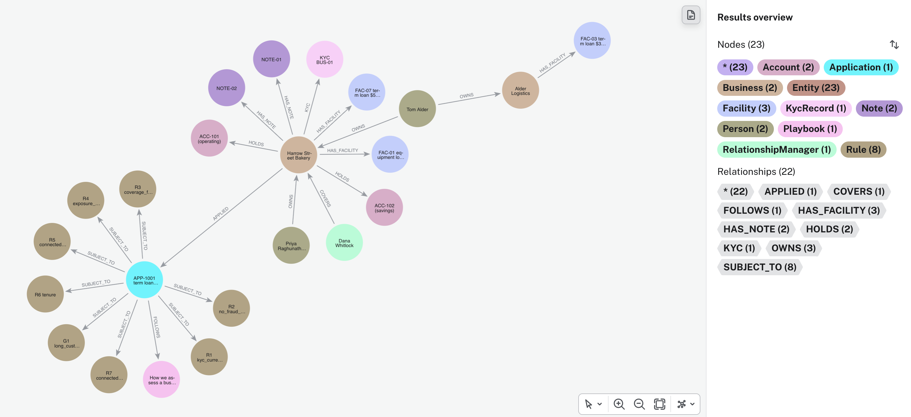
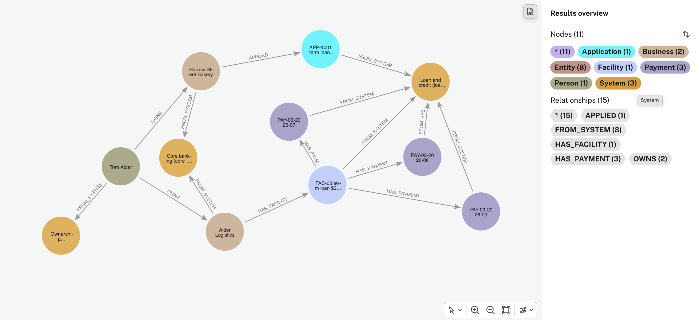
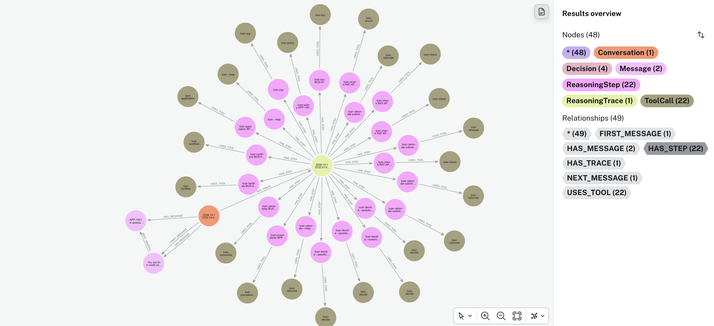
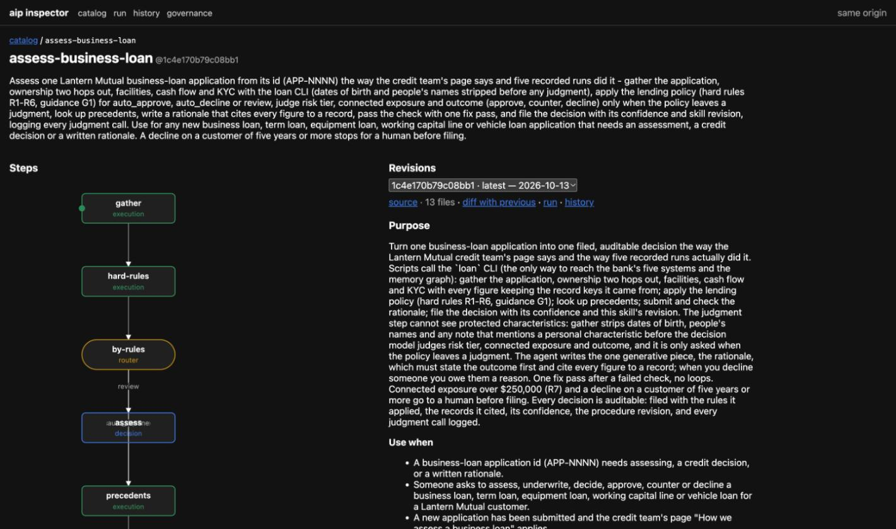
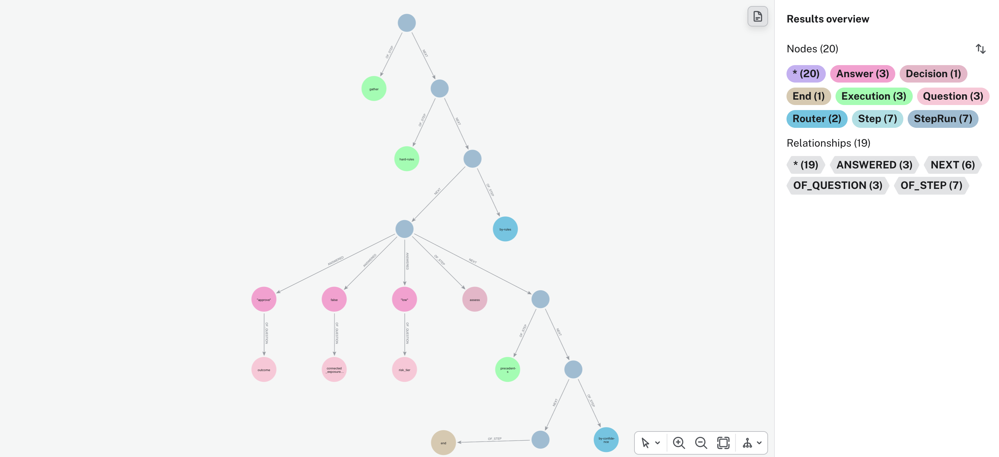
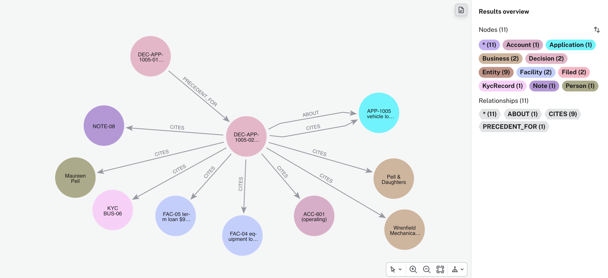
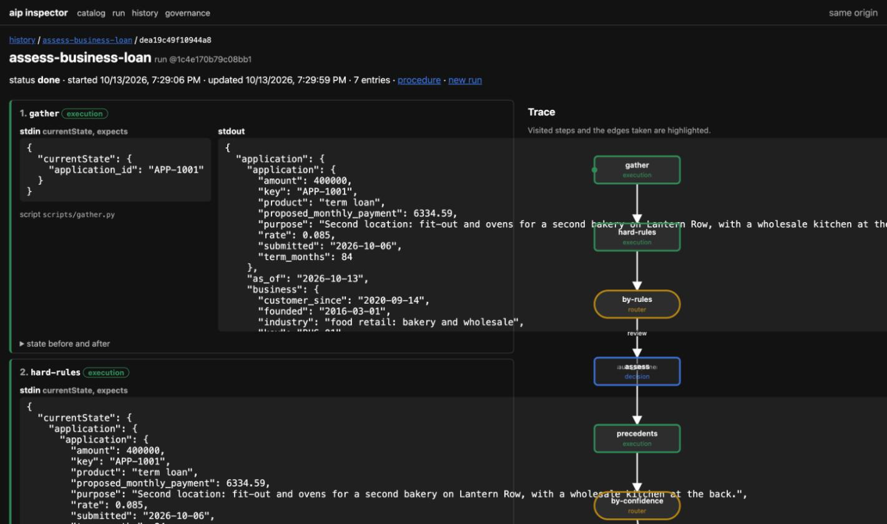
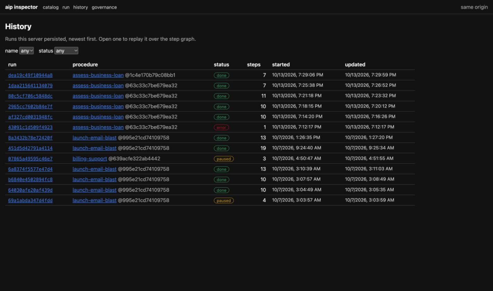

# A business-loan assessment on graph memory, distilled into a procedure

A worked example, with some light experimentation at the end. Five bank systems go into one graph;
an agent assesses loan applications over that graph and every step is recorded; the recordings are
distilled into a procedure that can be read, run, recorded and changed; and the same procedure is
then driven by a much smaller model to see what, if anything, is lost. It is the same three ideas as
the [email example](../aip-demo/README.md), on a problem where the explanation matters as much as
the answer:

1. Graph memory for agents. Five systems in one graph, so a fact that lives in none of them alone
   (an owner's other business is behind on a loan with the same bank) is one query away.
2. Skill distillation into a graph-shaped procedure (AIP). The evidence gathering is code, the
   judgment is a typed question with a probability, and the written rationale is the only thing the
   model writes.
3. Every decision filed back into the graph with the rules it applied, the records it cited, its
   confidence and the procedure revision that produced it. "How did you decide this one" becomes a
   query.

Everything about the bank, the applicants, the people and the policy is invented. No regulation is
named; three points are taken as given because they are what any lender would say: when you decline
someone you owe them a reason, the judgment step should not see protected characteristics, and every
decision should be auditable. The numbers at the end come from one build with one run per prompt, so
they show direction, not decimals.

## Prerequisites

- [uv](https://docs.astral.sh/uv/) and [Claude Code](https://claude.com/claude-code)
- Two Neo4j databases ([Aura](https://console.neo4j.io) Free is fine): one for agent memory, one
  for the aip server's catalog and run history. They must be separate: the catalog uses a `Decision`
  label of its own.
- `aip` and `aip-spec` installed, with the `aip` and `aip-runtime` skills in Claude Code:
  `curl -sSfL https://raw.githubusercontent.com/zach-blumenfeld/aip/aip-0.5a0/install.sh | bash`
  then `aip server --init` and fill in the Neo4j backend and the TypeSafe key, and
  `aip config --server http://localhost:8000`
- A [TypeSafe](https://typesafe.ai) API key (the aip server answers decisions with it; without it
  every decision pauses and asks you)
- In `loan-demo/`: `cp .env.example .env` (memory database credentials, TypeSafe key), `make sync`
  (`uv sync` and `uv tool install --editable .`, so `loan` is on PATH), `loan doctor`

## The problem

A small business applies to Lantern Mutual, a made-up bank, for a loan to open a second location.
Inside the bank someone pulls data from five systems, stitches it together by hand, and forms a
judgment that nobody can fully reconstruct later. The interesting facts are usually the ones that
sit across systems: the ownership register says who owns what, the loan book says which facilities
are late, and only by joining the two do you see that one of the applicant's owners is also the
majority owner of a business that is ninety days behind with the same bank.

The example runs in three stages, each of which can be inspected on its own:

1. An agent does the job over a graph that connects the five systems, writes a recommendation with
   its evidence, and every step is recorded. Then the same job four more times, and the runs are
   compared.
2. The recorded runs are distilled into a procedure. The evidence gathering becomes code that runs
   the same way every time; the judgment becomes three typed questions answered with a probability;
   the rationale is still written by the model, against the evidence, and checked before anything is
   filed; the filed decision becomes a precedent for the next one.
3. The procedure is run on a server, a rule is changed and revision 2 is published, and the whole
   thing is driven once more by a smaller model.

The point is not that any of this is faster, though some of it turned out to be. The point is that
at each stage you can say exactly what was done, show it for every run, and change it on purpose.

## The five systems

`tools/make_fixture.py` invents the bank and writes one JSON file per system into `data/bank/`:

| system | file | holds |
|---|---|---|
| Core banking | `core_banking.json` | 7 businesses, 10 accounts, 24 months of cash flow per account |
| Loan and credit | `loans.json` | 7 facilities, 144 payments (each current, late or missed), 5 applications |
| Compliance | `compliance.json` | 7 KYC records, the policy as `Rule` rows (R1–R6, G1; R7 is added later, in [Changing a rule](#changing-a-rule)), 1 fraud event |
| Ownership | `ownership.json` | 10 people (with a date of birth, on purpose), 12 ownership stakes with percentages |
| CRM | `crm.json` | 2 relationship managers, their coverage, 9 notes |

Plus the credit team's page `sop_assess_loan.md` ("How we assess a business loan", what the agent
reads) and the policy as prose, `policy.md`.

The policy, in short: KYC must be current (R1); no fraud event in twelve months (R2); debt service
coverage of 1.25 or better stands on its own, 1.00 to 1.25 is a judgment, under 1.00 is a decline
(R3); total exposure including the owners' other businesses stays under $1.5M (R4); anything sixty
days or more late at a business an owner holds a quarter or more of is never an automatic approval
(R5); under two years with the bank is a review (R6); and a decline on a customer of five years or
more goes to a human before it is filed (G1). The policy lives once, as code, in
`src/loan/policy.py`, and is shared by the agent's tools, the fixture check and the tests.

The applicants:

| application | business | ask | what the policy says |
|---|---|---|---|
| APP-1001 | Harrow Street Bakery, 6-year customer, coverage 1.6 | $400K term loan, second location | review: the 45% owner also holds 60% of Alder Logistics, whose $300K facility is 90 days late (R5). On its own the bakery is clean. |
| APP-1002 | Ridgeline Dental Partners, coverage 1.9 | $250K equipment loan | auto approve: nothing fires |
| APP-1003 | Corvid Print Co. | $150K working capital line | auto decline: KYC overdue (R1), a fraud event four months ago (R2) |
| APP-1004 | Mossbank Climbing Gym, 7-year customer | $600K term loan, second gym | review: coverage 1.15, inside the judgment band (R3); a signed lease and pre-sold memberships in the CRM notes. |
| APP-1005 | Pell & Daughters Plumbing, 3-year customer, coverage 1.4 | $200K vehicle loan | auto approve; the owner also holds 30% of a business whose facility is current; exposure $1.4M, close to the cap. Not used in the recordings, so the procedure meets it cold. |

`loan verify fixture` checks all of that from the JSON. `make fixture` regenerates the files; the
generator is deterministic.

## Import into graph memory

```
loan import          # the SDK writes the entities, typed edges are added; then counts what landed
```

450 entities through [neo4j-agent-memory](https://neo4j.com/labs/agent-memory/) (`Business`,
`Account`, `Month`, `Facility`, `Payment`, `Application`, `KycRecord`, `Rule`, `FraudEvent`,
`Person`, `RelationshipManager`, `Note`, `Playbook`, each also `Entity`), and 482 typed edges
written with the driver so Browser shows real edge types: `OWNS {pct}`, `HOLDS`, `HAS_CASHFLOW`,
`HAS_FACILITY`, `HAS_PAYMENT`, `APPLIED`, `KYC`, `HAD`, `SUBJECT_TO`, `COVERS`, `HAS_NOTE`,
`FOLLOWS`. Decision nodes are not imported; the agent files them later.

The applicant's world, two hops out (`queries.md`, query 1):

```cypher
MATCH (a:Application {key: 'APP-1001'})<-[p:APPLIED]-(b:Business)
MATCH p1 = (b)-[:HOLDS|HAS_FACILITY|KYC|HAD|HAS_NOTE]->()
MATCH p2 = (b)<-[:OWNS]-(:Person)
OPTIONAL MATCH p3 = (b)<-[:COVERS]-(:RelationshipManager)
OPTIONAL MATCH p4 = (a)-[:SUBJECT_TO|FOLLOWS]->()
OPTIONAL MATCH p5 = (b)<-[:OWNS]-(:Person)-[:OWNS]->(:Business)-[:HAS_FACILITY]->(:Facility)
RETURN a, p, b, p1, p2, p3, p4, p5
```



And the fact that lives in no single system (query 2): the application, its business, an owner, the
owner's other business, that business's facility, and the facility's missed payments.

```cypher
MATCH path = (a:Application {key: 'APP-1001'})<-[:APPLIED]-(:Business)<-[:OWNS]-(:Person)-[:OWNS]->(:Business)
             -[:HAS_FACILITY]->(:Facility)-[:HAS_PAYMENT]->(:Payment {status: 'missed'})
RETURN path
```



Query 2c in `queries.md` draws the same path with a virtual `System` node per source file, so the
picture also says where each node came from: the application, facility and payments from the loan
book, the businesses from core banking, the person from the ownership register. Nothing is written;
the labels map one to one onto the five files.

How the import works, file by file: [docs/import.md](docs/import.md). `loan import --rules-only`
updates the policy rules in place; it is how the rule change further down lands in the graph.

## Stage 1: the agent does the job, and is recorded

Claude Code gets one application and one instruction: start by reading the team's page (`loan sop`).
No skill. It has the `loan` command for the things an agent cannot do by hand:

| command | what it returns |
|---|---|
| `loan application <id>` | the application, the business, its owners as names and shares (never a date of birth), the relationship manager's notes |
| `loan ownership <business>` | the owners and every other business each holds 25% or more of, with those businesses' facilities and days late. Two hops, from the graph |
| `loan facilities`, `loan cashflow`, `loan kyc <business>` | facilities and payments; 12- and 24-month averages with the `Month` keys cited; the KYC record and fraud events |
| `loan policy <application>` | R1–R6 and G1 applied: outcome, the rules that fired with value, threshold and cites, every figure |
| `loan precedents <application>` | filed decisions on the same product in the same band |
| `loan rationale submit`, `loan check`, `loan record` | store the write-up; lint it; file it |
| `loan decide` | log a judgment call |

Every figure comes back with the keys of the nodes it was computed from, which is what makes
`loan check` possible: every `[cite: KEY]` in a rationale must name a node in the graph, every
dollar figure, ratio, percentage and day count must match a figure the systems hold, the first
paragraph must state the outcome, and no protected characteristic may be mentioned. `loan record`
refuses a rationale that has not passed.

Three Claude Code hooks write everything into the memory graph as it happens: the conversation, and
every `loan` call as a reasoning step with its tool call. Judgment calls logged with `loan decide`
get a `Decision` label. The SDK calls and the hook plumbing are the same as in the email example
([docs/recording.md](docs/recording.md)); `LOAN_RECORD=0` switches recording off.

The five recorded runs:

```
loan traces show run-01      # APP-1001; run-02 APP-1002, run-03 APP-1003, run-04 APP-1004, run-05 APP-1001 again
```

What run-01 did: read the page, pulled the application, the policy, the cash flow, the facilities,
KYC, then the ownership graph; found Alder Logistics at 90 days; logged four judgment calls (risk
tier medium; the connected exposure is material; outcome: refer, with a recommendation; no
precedents); wrote a rationale that bounced off the check twice (no cite markers and an uncited
interest rate the first time, the outcome not in the first paragraph the second) and passed the
third; filed `DEC-APP-1001-01` as refer with confidence 0.7.

One run in the graph, as a connected subgraph (query 3; `LIMIT 5` for all five):

```cypher
MATCH (c:Conversation)-[ht:HAS_TRACE]->(t:ReasoningTrace)
WITH c, ht, t ORDER BY t.started_at LIMIT 1
MATCH p1 = (c)-[:HAS_MESSAGE]->(:Message)
MATCH p2 = (t)-[:HAS_STEP]->(:ReasoningStep)-[:USES_TOOL]->(:ToolCall)
RETURN c, ht, t, p1, p2
```



What stands out across the five, reading the traces side by side:

- **Every run walked the ownership graph.** The team's page says to, and the agent did, every time.
  What differed was when: run-01 pulled policy, cash flow, facilities and KYC first and ownership
  seventh; run-05, the same application, pulled ownership right after the policy.
- **Wording.** Four runs asked what risk tier the business was, in three phrasings; run-03 never
  asked, the hard rules had decided. Run-04 logged seven judgments, run-01 four, including two
  nobody else asked (does one seven-day-late payment count against the applicant; does the
  five-year lease break undermine a ten-year term).
- **Precedents.** Run-04 found run-01's filed decision, judged it, and departed from it. Run-05
  found two and followed one. Run-01 had none.
- **The check earned its keep.** Run-01 bounced twice (no cite markers and an uncited interest
  rate, then the outcome missing from the first paragraph); the others passed first time.
- **The outcomes.** Refer (0.7), approve (0.92), decline (0.95), approve (0.75), refer (0.7). The
  two runs on the same application agreed. The coverage-band case (APP-1004) was approved by a
  model that said it was 75% sure, a number it chose for itself.

The judgment calls grouped across runs (query 4) are, in effect, the decision points of the
procedure, found by doing the job rather than by designing one up front:

```cypher
MATCH (d:Decision:ReasoningStep) WHERE d.question IS NOT NULL
RETURN d.question AS question, collect(d.answer) AS answers, count(*) AS times
ORDER BY times DESC
```

## Stage 2: distil the runs into a procedure

`loan traces export` reads the five runs back out of memory and writes `source/sop.md`,
`source/policy.md` and `source/traces.md`. One prompt (`prompts/author.md`) and the `aip` authoring
skill compile `skills/assess-business-loan/` from them: nine working steps, three routers, an end.
How: [docs/compile.md](docs/compile.md). `source/README.md` maps every step back to the page, the
policy or a trace, and lists what was dropped on purpose.

Top to bottom, one line per node. Scripts are Python, no model. Node 4 is a decision model with a
probability per answer. The agent writes the letter.

| # | node | who | what happens |
|---|---|---|---|
| 1 | gather | script | Pull everything the bank holds on the applicant, plus every other business any of its owners holds 25%+ of (all owners, all their businesses) and whether each is paying. Strip names and dates of birth. |
| 2 | hard-rules | script | Apply the policy:<br>R1 customer record (KYC) current, else decline<br>R2 no fraud event in 12 months, else decline<br>R3 cash flow covers all loan payments 1.25× or better; 1.00–1.25 review; under 1.00 decline<br>R4 total lending to the business and its owners' other businesses under $1.5M, else review<br>R5 any loan 60+ days late at any business any owner holds 25%+ of: review, never auto-approve<br>R6 under two years with the bank: review<br>G1 declining a business that has banked with us for 5+ years goes to a person before filing<br>Result: `auto_approve`, `auto_decline` or `review`, plus the rules that fired. |
| 3 | by-rules | branch | `auto_approve` or `auto_decline`: skip to 5. `review`: go to 4. |
| 4 | assess | model | Three questions, each answered with a probability:<br>1. `risk_tier`: choice of low / medium / high, threshold 0.6. How risky is the business: its own cash cover, payment record, balances, lifted for any owner's other businesses in arrears or an expansion the numbers give no credit to.<br>2. `connected_exposure_material`: noul (yes/no), threshold 0.3. Does trouble at any of the owners' other businesses, taken together, change this decision.<br>3. `outcome`: choice of approve / counter / decline, threshold 0.6. The lending decision: full amount, smaller or shorter, or no.<br>Any answer under its threshold: pause, a person answers it. |
| 5 | precedents | script | Look up earlier filed decisions on the same loan product in the same policy band. Then settle:<br>outcome = approve if `auto_approve`, decline if `auto_decline`, the model's answer if `review`<br>confidence = 1.0 if the rules decided, 0.6 if the model did<br>`needs_human` = true if outcome is decline and the business has banked with us for 5+ years (G1)<br>evidence digest = every figure with the id of the record it came from, the only material the letter may quote |
| 6 | by-confidence | branch | `needs_human` true: go to 13, unfiled. Else: go to 7. |
| 7 | rationale | agent | Write the decision letter. First words "Outcome: …". Every number cites a record. No person named. |
| 8 | check | script | Lint it: every cite exists, every number matches a record, outcome up front, no protected words. |
| 9 | gate | branch | Passed: 12. First failure: 10. Second failure: 13, unfiled. |
| 10 | fix | agent | Fix exactly what the check named. Once. |
| 11 | recheck | script | Lint again. Back to 9. |
| 12 | record | script | Write a Decision node into the memory graph with outcome, confidence, revision, edges to every cited record and applied rule. |
| 13 | end | | Returns: `application_id`; `outcome` (approve / counter / decline); `needs_human` (true/false); `decision_id`, the key of the Decision node from 12, e.g. `DEC-APP-1005-02`, empty if unfiled; `note`, one paragraph: what was filed, or what a person must do. |

Two places a person enters: a low-probability answer at 4, or the flag at 6.

Revision 2: one change at 5. A fired R7 rule (lending to the owners' group over $250K) also sets `needs_human`.

Two steps are worth a closer look. `gather`, because it is what the free-form runs did in five
orders, and is now code that runs the same way every time. And `assess`, because the typed answers
with a probability are where the consistency comes from, and because its declared inputs are the
whole list of what the judgment may see.

The decisions are answered by a System One model, TypeSafe's Jev ([System One](https://docs.typesafe.ai/concepts/system-one)):
a fixed question about an input, a typed value with a calibrated probability, and a threshold under
which a human is asked. AIP is the [Agent Instruction Protocol](https://github.com/zach-blumenfeld/aip/tree/aip-0.5a0),
format 0.5a1, with a server that walks the graph and a client that only sees the pauses.

Publish it and look at it as a graph (query 5, in the aip database):

```
aip server --inspector                     # http://localhost:8000/inspector/
aip publish ./skills/assess-business-loan
```

```cypher
MATCH (:Name {name: 'assess-business-loan'})-[:HAS_REVISION]->(s:Skill)-[:HAS_PROCEDURE]->(:Procedure)-[:HAS_STEP]->(st:Step)
WITH s, st ORDER BY s.published_at DESC
OPTIONAL MATCH e = (st)-[:INPUTS_TO|BRANCH]->(:Step)
RETURN st, e
```

The same graph in the inspector:



## Stage 3: run it through the server

```
make fresh                        # forget earlier local runs and rationales
claude
> Assess application APP-1005 for Pell & Daughters Plumbing.
```

The agent's `aip-runtime` skill searches the catalog, inspects the match, starts the run, and
answers the pauses. The server runs the scripts, sends the decision to Jev, follows the routers, and
records every step against the revision that ran. What happened
([checkpoints/04-live-runs.md](checkpoints/04-live-runs.md) has the raw session figures):

- **APP-1005, twice.** Ten steps each, the same ten. The policy returned auto approve, so the
  judgment step was skipped. One pause each, the rationale; the check passed first time. The two
  filed decisions have the same outcome, the same fired rules (none) and the same 21 cited keys,
  and the second carries a `PRECEDENT_FOR` edge from the first.
- **APP-1004, the coverage-band case.** Eleven steps: the policy returned review, so Jev was asked.
  It answered above every threshold (risk tier medium at 0.89; connected exposure not material;
  approve at 0.73), so the run did not pause for a human. The expectation going in was that it
  would; the model was sure, the evidence it saw supports approve, and the run is kept as it
  happened. The confidence filed is the threshold cleared (0.6); the probabilities are on the
  `Answer` nodes.
- **APP-1001, the connected-delinquency case.** The policy returned review (R5). Jev was sure the
  connected exposure is material (0.97) and leaned decline (0.82), but its risk-tier answer fell
  under the 0.6 threshold, so the run paused for a review and the agent answered it. Decline on a
  six-year customer is G1, so the run ended unfiled with a note for a human.

The run in the aip database (query 6), `Run → StepRun → Answer → Question`, and what the `assess`
step received, stored on every run (6b): the figures, the fired rules, the ownership summary as
shares, tenure, KYC status, the filtered notes. No date of birth, no name. This is stronger than
"the model was told to ignore those things": it could not see them, and that can be shown for every
decision.

```cypher
MATCH (r:Run {name: 'assess-business-loan'})-[:STEP_RUN]->(sr:StepRun {step: 'assess'})
RETURN r.id AS run, r.revision AS revision, sr.input AS input_the_model_saw, sr.result AS answers_with_probabilities
ORDER BY r.started_at DESC LIMIT 3
```



And the decision trace in memory (query 7): `Decision → CITES → the evidence`, `APPLIED_POLICY →
the rules`, `PRECEDENT_FOR` from the decision before it.

```cypher
MATCH (d:Decision:Filed)-[:ABOUT]->(a:Application {key: 'APP-1005'})
WITH d ORDER BY d.at DESC LIMIT 1
MATCH p1 = (d)-[:ABOUT]->(:Application)
OPTIONAL MATCH p2 = (d)-[:APPLIED_POLICY]->(:Rule)
OPTIONAL MATCH p3 = (d)-[:CITES]->(n) WHERE NOT n:Month
OPTIONAL MATCH p4 = (d)<-[:PRECEDENT_FOR]-(:Decision)
RETURN d, p1, p2, p3, p4
```



## Changing a rule

A compliance officer adds one rule: R7, connected exposure over $250,000 always goes to a human.
It goes into `compliance.json` and `policy.md`, and into the graph with `loan import --rules-only`,
which updates the rule nodes in place and leaves every edge earlier decisions made to them. The
bank's policy engine now reports R7 with effect `human`. Revision 1 of the procedure would see it
fire and file anyway; revision 2 changes one script so `by-confidence` sends a fired `human` rule to a
person. `aip validate`, `aip publish`, revision 2.

APP-1001 again: R5 and R7 fire, Jev is asked, the risk tier pauses for a review again, and the run
ends for a human with a note that names R7. The run record carries revision 2. The two runs on the
same application sit side by side in the aip database (query 8):

```cypher
MATCH (r:Run {name: 'assess-business-loan'})-[:STEP_RUN]->(sr:StepRun)
WITH r, sr ORDER BY sr.order
WITH r, collect(sr.step) AS steps,
     [s IN collect(sr) WHERE s.step = 'hard-rules' | s.result][0] AS rules,
     [s IN collect(sr) WHERE s.step = 'precedents' | s.result][0] AS routed
WHERE rules CONTAINS 'APP-1001'
RETURN r.id AS run, r.revision AS revision, steps,
       CASE WHEN routed CONTAINS 'R7 connected_exposure_cap' THEN 'stopped for a human: R7 connected exposure over the cap'
            WHEN routed CONTAINS 'NOT FILED' THEN 'stopped for a human: G1 decline on a long-standing customer'
            ELSE 'filed' END AS why_it_stopped
ORDER BY r.started_at
```

The revision-2 run replayed over its step graph in the inspector, and every server run in the
history view with the revision each ran against:





This is the property the whole example turns on: the procedure is a thing you can read, run, record
and change, not a prompt somebody tuned. A rule has consequences, and the graph shows exactly which.
R7 also catches APP-1005 (its owner's other business carries a $950K facility), so from revision 2
that applicant goes to a human too, which may or may not be what the compliance officer intended.

## Swapping the driving model

A small experiment, run the day after. The procedure's scripts are Python and its decision step is
Jev, so the only place a Claude model sits in a server run is the Claude Code session that drives
the `aip-runtime` skill: it finds the skill, starts the run, writes the rationale at the pause,
answers any review pause, and resumes. If the procedure really carries the work, that session should
not need a large model.

The same three prompts were run with `--model claude-haiku-5-5` on that session and nothing else
changed (revision 2, R7 in the graph, Jev on the decision step), plus one Fable session on APP-1005
for a same-day baseline, since the earlier APP-1005 runs predate R7. Details and Jev's answers per
run: [checkpoints/05-haiku-runs.md](checkpoints/05-haiku-runs.md).

| application | model | wall | API time | cost | turns | output tokens | pauses | ended |
|---|---|---|---|---|---|---|---|---|
| APP-1005 | Haiku 5.5 | 83 s | 20 s | $0.013 | 9 | 3.5K | 2 (review) | unfiled, R7 |
| APP-1005 | Fable 5.1 | 114 s | 68 s | $0.94 | 9 | 3.1K | 2 (review) | unfiled, R7 |
| APP-1004 | Haiku 5.5 | 164 s | 53 s | $0.021 | 13 | 10.2K | 1 (rationale) | DEC-APP-1004-03 |
| APP-1004 | Fable 5.1 (day before) | 195 s | 104 s | $1.63 | 17 | 8.9K | 1 (rationale) | DEC-APP-1004-02 |
| APP-1001 | Haiku 5.5 | 106 s | 35 s | $0.014 | 12 | 5.3K | 1 (review) | unfiled, R7 |
| APP-1001 | Fable 5.1 (day before) | 115 s | 64 s | $1.15 | 13 | 4.9K | 1 (review) | unfiled, R7 |

Haiku's APP-1004 decision equals Fable's: approve, 0.6, R3, the same 35 cited keys, check passed
first time, `PRECEDENT_FOR` from the Fable decision. Its APP-1001 and APP-1005 runs took the same
steps, paused at the same answers and ended the same way. One wobble: the APP-1001 session resumed
a finished run a second time, which the server accepted and the result ignored. On this evidence
the procedure carries the quality and the driving model is swappable, with the usual caveat that
it is three runs. The cost column is Claude Code's list-price estimate, so the gap is a pricing
fact rather than a measure of effort.

## Side by side

| free-form agent (stage 1) | procedure (stages 2 and 3) | where to look |
|---|---|---|
| ownership walked in a different place each run | `gather` walks `OWNS` two hops every run; it is a script | query 6, the same steps every run |
| evidence chosen differently each run | one gather step, node keys on every figure | the `CITES` edges, query 7 |
| judgment worded differently each run, confidence self-reported | typed answers with probabilities; under threshold, a human | the `Answer` nodes, the APP-1001 review pause |
| a rationale could state a number with nothing behind it | the check rejects any cite or figure not in the evidence | run-01's two bounces; the procedure runs passing first time |
| a different path each time, no record of which | the same path, every run recorded against the revision that ran it | query 8 |
| change the behaviour by editing a prompt and hoping | change one rule and one script, validate, publish revision 2; old runs still point at revision 1 | [Changing a rule](#changing-a-rule) |
| nothing learned for next time | `record` files the decision; `precedents` reads it | `PRECEDENT_FOR` on the second APP-1005 run |
| lives in one agent's prompt | one `SKILL.md`: server with Jev, or a plain agent walk | `aip run ./skills/assess-business-loan` |

What is measured and shown: how many runs, which steps each took, where a human was asked, that two
runs on the same applicant match, and what each run cost ([Metrics](#metrics)).

## What changed, in numbers

Three configurations, same five applications, same bank data. "Fable alone" is Claude Code with the
`loan` command and the team's page, no procedure. "Fable + procedure" and "Haiku + procedure" are
the published skill on the aip server, driven by a Claude Code session on that model; the
decision step is answered by Jev either way. Averages per run from the tables in
[Metrics](#metrics); one build, a handful of runs, so read direction, not decimals.

**1. Performance**

| per run | Fable alone | Fable + procedure | Haiku + procedure |
|---|---|---|---|
| wall clock | 7.4 min | 2.7 min | 2.0 min |
| model time | 2.7 min | 1.4 min | 0.6 min |
| turns | 24 | 14 | 11 |
| cost (list price) | $1.03 | $1.31 | $0.02 |

Wall clock is the stopwatch from prompt to answer. Model time is the part spent waiting on the
model; the rest is tools, scripts and the server doing the work. Fable to Fable: the procedure cuts
wall time by about 2.7× and turns by about half, and does not save money, because the session is
still a Fable session answering the pauses. Fable alone to Haiku with the procedure: wall time
down 3.7×, model time down 4.5×, cost down about 60×. The procedure cost $9.70 and 20 minutes to
author, once.

**2. Accuracy and trust**

| | Fable alone | Fable + procedure | Haiku + procedure |
|---|---|---|---|
| outcome agrees with the policy | 5 of 5 | 5 of 5 | 3 of 3 |
| same applicant, same decision | yes (APP-1001 twice) | yes, to the cited key (APP-1005 twice) | yes, to the cited key (APP-1004 vs Fable) |
| rationale passed the check first time | 3 of 5 (run-01 bounced twice) | every time | every time |
| confidence | self-reported | Jev's probabilities, stored | Jev's probabilities, stored |
| when the model is unsure | it says so, in prose | the run stops and asks a person | the run stops and asks a person |
| what the model saw | names, notes, whatever it pulled | figures only; no name, no date of birth, provable per run | same |

The procedure does not make the model smarter. It makes the answer the same every time, puts a
number on how sure the judgment was, and stops when that number is low. Haiku, a far smaller
model, produced the same decision as Fable on the case that filed, with the same 35 citations.

**3. Governance and traceability**

| | Fable alone | with the procedure (either model) |
|---|---|---|
| what is recorded | the conversation and every tool call, as it happened | every step, its input and its output, against the revision that ran |
| the path taken | different each run | the same steps every run; ownership walked by a script, not by the model |
| the rules | in a page the model reads | in code the model cannot skip |
| changing behaviour | edit the page and hope | change one rule and one script, validate, publish revision 2; old runs still point at revision 1 |
| human override | not captured as such | on the `Answer` node: what the model said, what the person said |
| the filed decision | cites, applied rules, precedent | the same, plus the revision and the stored judgment |

**What this does not show.** It is one build with one run per prompt, so the time and cost
figures are an order of magnitude, not a benchmark. There is no human-labelled set, so accuracy
means agreement with the policy and between runs. And the procedure only covers what it was
authored from: the five recordings.

## Metrics

Everything below is what the harness recorded during one build on 2026-10-13 (the Haiku runs on
2026-10-14): the `usage` and `duration_ms` fields of each headless
`claude -p --output-format json` session, kept in `checkpoints/02-runs.json`,
`checkpoints/04-live-runs.md` and `checkpoints/05-haiku-runs.md`. One build, one run of each
prompt, no repeats; read them as an order of magnitude, not a benchmark.

**Models.** Every Claude Code session in the build (the five recordings, the authoring, the five
server-run sessions) ran on `claude-fable-5-1`, the default model, with no `--model` flag; the
model swap above used `claude-haiku-5-5`. Decision steps on the server were answered by TypeSafe's
`jev-latest`. The policy engine, the check and the gather step are plain Python with no model in
them.

**Free-form recordings** (Claude Code with the `loan` command, no skill, hooks recording).

| run | application | wall | API time | cost | turns | output tokens | cache-read tokens | rationale attempts |
|---|---|---|---|---|---|---|---|---|
| run-01 | APP-1001 | 635 s | 245 s | $1.43 | 31 | 11.2K | 487K | 3 |
| run-02 | APP-1002 | 373 s | 129 s | $0.74 | 22 | 5.9K | 160K | 1 |
| run-03 | APP-1003 | 360 s | 121 s | $0.73 | 22 | 5.9K | 172K | 1 |
| run-04 | APP-1004 | 494 s | 203 s | $1.24 | 25 | 10.9K | 334K | 1 |
| run-05 | APP-1001 | 351 s | 109 s | $1.00 | 20 | 8.0K | 236K | 1 |

Five decisions in 37 minutes for $5.14. Fresh input tokens are 300 to 600 per run; the spend is
cache reads and output. Wall time is about twice API time; the rest is the hooks and the `loan`
subprocesses.

**Authoring the procedure** (one headless session over `prompts/author.md` and the exported
source): 20 minutes, 76 turns, $9.70, 73K output tokens, 4.3M cache-read tokens. The most expensive
step in the build.

**Server runs of the published procedure** (a Claude Code session with the `aip-runtime` skill
driving the server; the server runs the scripts and asks Jev).

| run | application | revision | wall | API time | cost | turns | pauses | check first pass | ended |
|---|---|---|---|---|---|---|---|---|---|
| 1 | APP-1005 | 1 | 174 s | 64 s | $0.96 | 10 | 1 (rationale) | yes | DEC-APP-1005-01 |
| 2 | APP-1005 | 1 | 209 s | 115 s | $1.47 | 13 | 1 (rationale) | yes | DEC-APP-1005-02 |
| 3 | APP-1004 | 1 | 195 s | 104 s | $1.63 | 17 | 1 (rationale) | yes | DEC-APP-1004-02 |
| 4 | APP-1001 | 1 | 128 s | 80 s | $1.35 | 15 | 1 (review) | n/a | unfiled, G1 |
| 5 | APP-1001 | 2 | 115 s | 64 s | $1.15 | 13 | 1 (review) | n/a | unfiled, R7 |

Per decision the procedure is about 2.7 times faster on the wall clock (164 s against 443 s) and
not cheaper ($1.31 against $1.03): the Claude session is still there answering the pauses, and the
`aip-runtime` skill is a large cached prompt. The Jev calls and the script time inside the server
were not measured separately. A plain `aip run` with no Claude session in the loop would cost only
the Jev calls; that was not timed.

The Haiku sessions are in [Swapping the driving model](#swapping-the-driving-model).

**Agreement.** There is no labelled set, so accuracy means agreement with the policy and between
runs.

- The policy engine is deterministic and verified against the expected outcome, fired rules and
  coverage of all five applications, in the JSON fixture and in the graph (`loan verify fixture`,
  `loan verify import`).
- Every free-form outcome agrees with the policy: the two auto cases were filed approve and
  decline; the two review cases went refer (APP-1001) and approve (APP-1004). Run-05 reproduced
  run-01: the same four judgment calls, the same outcome, the same confidence.
- The two procedure runs on APP-1005 match: same outcome, same fired rules, the same 21 cited keys.
- The procedure agreed with the free-form agent on APP-1004 (approve) and on APP-1001 (both ended
  with a human deciding, by different routes: refer in stage 1, G1 and then R7 on the server).
- The check: seven submissions for five free-form rationales, all of the retries in run-01. Every
  procedure rationale passed first time.
- What moves: Jev's risk-tier confidence on APP-1001 was 0.40 on one run, 0.27 on the next and
  0.25 on the Haiku run. The review pause is real; the probabilities are not stable.

## Files

```
data/bank/              the five systems, the team's page, the policy as prose
src/loan/               policy.py (the rules as code), tools.py (the loan command), importer.py, hooks.py, record.py, cli.py
tools/make_fixture.py   regenerates data/bank/ (deterministic)
prompts/                runs.yaml (the five recorded runs), author.md (the compile prompt)
skills/assess-business-loan/   the procedure: SKILL.md, scripts/, assets/, source/
checkpoints/            01-import.json, 02-runs.json, traces/, 03-publish.json, 04-live-runs.md, 05-haiku-runs.md, start-app-*.json
checkpoints/skill-revisions/   both published revisions as the server has them (rev1-…, rev2-…) and rev1-to-rev2.diff
queries.md              the numbered Browser queries referenced above, tested
docs/                   import.md, recording.md, compile.md, STORY.md
```

`make sync doctor import record export author publish` is the pipeline from a clean memory database;
`loan verify fixture|import|traces` check each stage.

## Additional resources

- neo4j-agent-memory: https://neo4j.com/labs/agent-memory/
- AIP: https://github.com/zach-blumenfeld/aip/tree/aip-0.5a0 ; spec: https://github.com/zach-blumenfeld/aip-spec ; paper: https://arxiv.org/abs/2606.04781
- TypeSafe: https://docs.typesafe.ai/
- Other Neo4j + AI resources: https://neo4j.com/developer/ai
